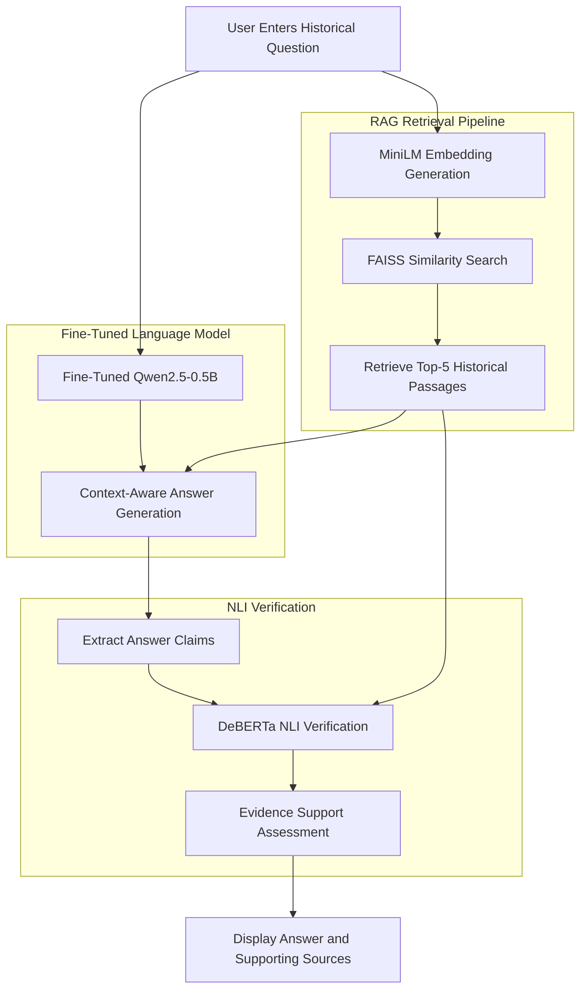

# HistoryQA – An Evidence-Grounded Historical Question Answering Assistant

<p align="center">
  <strong>An AI-powered historical question-answering system combining Fine-Tuned Large Language Models, Retrieval-Augmented Generation (RAG), and Natural Language Inference (NLI) verification.</strong>
</p>

<p align="center">
  
  
  
  
  
  
</p>

---

## 1. Project Overview

**HistoryQA** is an evidence-grounded historical question-answering assistant designed to provide informative responses to questions related to historical events, personalities, civilizations, revolutions, and other historical topics.

The system combines two major approaches:

1. **Fine-Tuning:** Adapts a lightweight Large Language Model (LLM) using LoRA/QLoRA techniques to improve its task-specific question-answering behaviour.
2. **Retrieval-Augmented Generation (RAG):** Retrieves relevant historical information from an external knowledge base and provides contextual evidence to the language model.

An additional Natural Language Inference (NLI) verification layer evaluates whether generated answer claims are supported by the retrieved evidence.

HistoryQA aims to reduce unsupported responses by combining model adaptation, external knowledge retrieval, and evidence-support verification.

## 2. Problem Statement

Traditional Large Language Models generate responses based on knowledge encoded in their parameters. Although they can produce fluent answers, they may sometimes:

- Generate historically inaccurate information.
- Provide incomplete explanations.
- Produce unsupported historical claims.
- Fail to identify when sufficient evidence is unavailable.
- Struggle with questions requiring specific historical context.

Fine-tuning alone does not guarantee access to updated or comprehensive historical information. Similarly, retrieval alone does not guarantee that a language model will consistently use retrieved evidence correctly.

HistoryQA addresses these limitations through a combined architecture integrating fine-tuning, retrieval, and verification.

## 3. Project Objectives

- Develop a historical question-answering assistant using a fine-tuned LLM.
- Adapt Qwen2.5-0.5B-Instruct using LoRA/QLoRA.
- Construct a historical knowledge base using Wikipedia articles.
- Generate semantic embeddings using Sentence Transformers.
- Implement similarity-based retrieval using FAISS.
- Supply retrieved historical passages as contextual evidence.
- Verify generated answer claims using DeBERTa NLI.
- Provide an interactive interface using Streamlit.
- Support evidence-aware responses and flag insufficiently supported answers.

## 4. System Architecture

HistoryQA consists of three major stages:

### A. Fine-Tuning Pipeline

The fine-tuning pipeline adapts the pretrained language model for historical question-answering tasks.

**Components:**

| Component | Technology | Purpose |
|---|---|---|
| Base LLM | Qwen2.5-0.5B-Instruct | Pretrained language model |
| Fine-tuning | LoRA / QLoRA | Parameter-efficient model adaptation |
| Training data | Historical QA dataset | Task-specific training examples |
| Model format | Hugging Face Safetensors | Model storage and deployment |

**Implementation process:**

1. Load the pretrained Qwen2.5-0.5B-Instruct model.
2. Prepare a curated historical question-answering dataset.
3. Divide the dataset into training and validation subsets.
4. Configure LoRA/QLoRA parameters.
5. Fine-tune the model using the prepared examples.
6. Evaluate training and validation loss.
7. Merge the trained LoRA adapter with the base model.
8. Save the merged model in Safetensors format.

The resulting model is used for answer generation during inference.

### B. Retrieval-Augmented Generation (RAG) Pipeline

The RAG pipeline provides external historical knowledge to the language model.

**Components:**

| Component | Technology | Purpose |
|---|---|---|
| Knowledge base | Wikipedia historical articles | External historical information |
| Embeddings | all-MiniLM-L6-v2 | Semantic text representation |
| Vector database/index | FAISS | Similarity-based document retrieval |
| Retrieval strategy | Top-5 retrieval | Retrieve relevant passages |

**Implementation process:**

1. Collect historical Wikipedia articles.
2. Extract and clean article text.
3. Divide articles into smaller text chunks.
4. Convert each chunk into a 384-dimensional embedding using MiniLM.
5. Normalize the embedding vectors.
6. Create a FAISS `IndexFlatIP` vector index.
7. Store the index, embeddings, chunks, and metadata.
8. Convert incoming user questions into embeddings.
9. Retrieve the five most relevant passages.
10. Supply retrieved passages to the fine-tuned LLM as contextual evidence.

### C. NLI-Based Verification Pipeline

HistoryQA incorporates a Natural Language Inference model to evaluate the relationship between generated answer claims and retrieved historical evidence.

**Component:**

| Component | Technology | Purpose |
|---|---|---|
| Verification model | cross-encoder/nli-deberta-v3-small | Evidence-support classification |
| Verification method | Natural Language Inference | Evaluate claim-evidence relationships |

The verification model evaluates three relationships:

- **Entailment:** Retrieved evidence supports the generated claim.
- **Contradiction:** Retrieved evidence conflicts with the generated claim.
- **Neutral:** Retrieved evidence does not establish the claim.

The system uses evidence relevance and NLI confidence thresholds to determine whether generated claims are sufficiently supported.

This verification layer helps identify unsupported statements and supports evidence-aware response handling.

**Note:** NLI verification evaluates textual support; it does not independently establish historical truth.

## 5. Complete System Workflow



### End-to-End Execution

1. The user submits a historical question through the Streamlit application.
2. MiniLM converts the question into a semantic embedding.
3. FAISS searches the historical vector index.
4. The system retrieves the five most relevant passages.
5. Retrieved passages are combined with the user question.
6. The fine-tuned Qwen model generates an answer using the supplied context.
7. Generated answer claims are evaluated using DeBERTa NLI.
8. The application assesses evidence support and applies its response-handling logic.
9. The final response, supporting sources, and available verification information are presented to the user.

## 6. Technologies Used

| Technology | Application |
|---|---|
| Python | Core implementation |
| PyTorch | Deep learning framework |
| Hugging Face Transformers | Language model loading and inference |
| Qwen2.5-0.5B-Instruct | Base language model |
| PEFT | Parameter-efficient fine-tuning |
| LoRA / QLoRA | Fine-tuning methodology |
| Sentence Transformers | Text embedding generation |
| all-MiniLM-L6-v2 | Embedding model |
| FAISS | Vector similarity search |
| DeBERTa NLI | Evidence-support verification |
| Safetensors | Model serialization |
| Streamlit | Interactive web application |
| NumPy | Numerical operations |

## 7. Dataset and Knowledge Base

### Fine-Tuning Dataset

The prototype uses a curated historical question-answering dataset.

| Dataset component | Count |
|---|---:|
| Total examples | 28 |
| Training examples | 23 |
| Validation examples | 5 |

The dataset is used to adapt the model's historical question-answering behaviour.

### Historical Knowledge Base

The retrieval pipeline uses Wikipedia historical articles.

| Component | Implementation |
|---|---|
| Source | Wikipedia articles |
| Articles collected | 30 |
| Generated text chunks | 938 |
| Average chunk size | Approximately 444 words |
| Embedding dimensions | 384 |
| Retrieval method | FAISS IndexFlatIP |
| Retrieved passages | Top 5 |

The knowledge base and vector index are stored separately from the language model.

## 8. Model Evaluation

The fine-tuning process monitors training and validation loss to assess model learning.

The recorded best validation loss during the prototype training process was approximately **0.6897**, around epoch 3.

This is a loss measurement, not an accuracy score.

The system should be evaluated further using:

- Answer correctness.
- Retrieval relevance.
- Evidence coverage.
- Claim-level entailment.
- Contradiction detection.
- Unsupported claim rate.
- Response latency.
- Abstention behaviour.

A larger independently labelled test dataset is required to establish reliable performance metrics.

## 9. Project Structure

The project is organized into model, application, and knowledge-base components.

```text
HistoryQA_Complete_Project/
│
├── app/
│   └── app.py
│
├── models/
│   └── merged_model/
│       ├── config.json
│       ├── generation_config.json
│       ├── model.safetensors
│       ├── tokenizer.json
│       ├── tokenizer_config.json
│       └── special_tokens_map.json
│
├── data/
│   ├── historyqa_faiss.index
│   ├── historyqa_metadata.json
│   ├── historical_chunks.json
│   └── historyqa_embeddings.npy
│
├── README.md
├── requirements.txt
└── .gitignore
```

Additional Python modules and supporting files may be present depending on the implementation.

## 10. Installation and Setup

### Prerequisites

- Python 3.11 or compatible environment.
- Git.
- Git LFS.
- Minimum 8 GB RAM recommended; 16 GB is preferable for local CPU inference.
- Internet connection for initial dependency installation.

### Step 1: Clone the Repository

```bash
git clone https://github.com/Yaseen-2004/HistoryQA-An-evidence-grounded-historical-question-answering-assistant.git

cd HistoryQA-An-evidence-grounded-historical-question-answering-assistant
```

### Step 2: Set Up Git LFS

The merged model is approximately 942 MB and is stored using Git Large File Storage.

```bash
git lfs install
git lfs pull
```

### Step 3: Create a Virtual Environment

Windows:

```powershell
python -m venv .venv

.venv\Scripts\activate
```

Linux/macOS:

```bash
python -m venv .venv

source .venv/bin/activate
```

### Step 4: Install Dependencies

```bash
python -m pip install --upgrade pip

pip install -r requirements.txt
```

### Step 5: Launch the Application

From the project root:

```bash
python -m streamlit run app/app.py
```

The application should be accessible at:

```text
http://localhost:8501
```

**Important:** The model, data, and supporting files must be available at the paths expected by the application. Verify these paths before launching.

## 11. Hardware and Deployment

### Training Environment

The fine-tuning workflow was designed for Google Colab with an NVIDIA T4 GPU and approximately 15 GB GPU memory.

LoRA/QLoRA reduces the memory requirements of fine-tuning compared with full-parameter training.

### Local Inference Environment

The local deployment uses CPU-based inference with the merged model.

The merged model is stored in FP16 Safetensors format. Local CPU loading may use FP32 depending on the model-loading configuration.

GPU acceleration is not required by the local CPU inference workflow, although inference may be slower.

## 12. Key Features

- Fine-tuned historical question answering.
- Retrieval-Augmented Generation.
- Semantic search across historical documents.
- Top-5 evidence retrieval.
- Claim-level NLI verification.
- Evidence-aware response handling.
- Local model deployment.
- Interactive Streamlit interface.
- Hugging Face-compatible model storage.

## 13. Limitations

- The fine-tuning dataset is relatively small.
- The knowledge base is limited to the collected historical articles.
- Wikipedia content may contain omissions or inaccuracies.
- Retrieval relevance depends on embedding quality and document chunking.
- NLI verification does not prove that a historical claim is objectively true.
- The current prototype requires broader testing on independently labelled questions.
- CPU inference can introduce additional response latency.

## 14. Future Enhancements

- Expand the historical knowledge base with academic and archival sources.
- Improve document chunking and metadata filtering.
- Introduce hybrid retrieval using keyword and semantic search.
- Evaluate alternative embedding models and reranking techniques.
- Improve claim extraction and multi-passage evidence verification.
- Develop a larger benchmark dataset for historical question answering.
- Add multilingual historical question answering.
- Optimize model inference and response latency.
- Introduce source reliability and evidence provenance scoring.

## 15. Research Contribution

HistoryQA explores the integration of three complementary capabilities:

1. **Task-specific model adaptation:** Fine-tuning a compact language model for historical question answering.
2. **External knowledge grounding:** Retrieving relevant historical passages using semantic embeddings and vector similarity search.
3. **Evidence-support verification:** Applying Natural Language Inference to assess whether generated answer claims are supported by retrieved passages.

The project focuses on investigating how these components can work together to improve evidence-grounded historical question answering.

The combination itself is not claimed as a new standalone technique; its effectiveness requires systematic empirical evaluation.

## 16. Author

**Syed Mohammed Yaseen**

B.Tech – Computer Science and Engineering  
Specialization: Artificial Intelligence and Machine Learning  
Presidency University, Bengaluru

- GitHub: [@Yaseen-2004](https://github.com/Yaseen-2004)
- LinkedIn: [Syed Mohammed Yaseen](https://www.linkedin.com/in/syed-mohammed-yaseen-589766291/)

## 17. Repository

**GitHub:**  
[HistoryQA – An Evidence-Grounded Historical Question Answering Assistant](https://github.com/Yaseen-2004/HistoryQA-An-evidence-grounded-historical-question-answering-assistant)

---

## License

This project is intended for educational and research purposes. Check the licenses of the pretrained models, datasets, and external resources before redistribution or commercial use.
